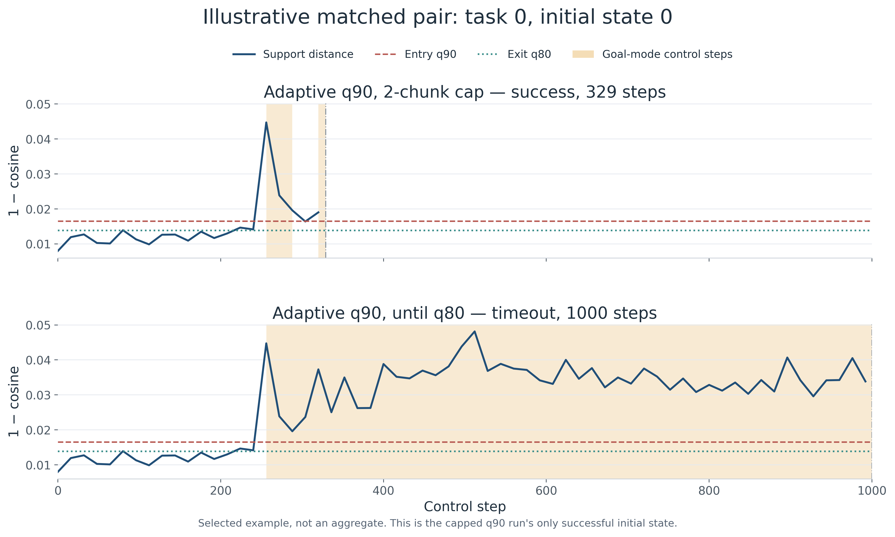
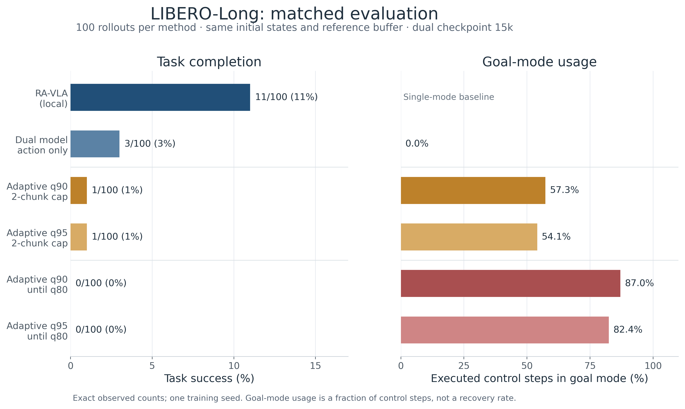
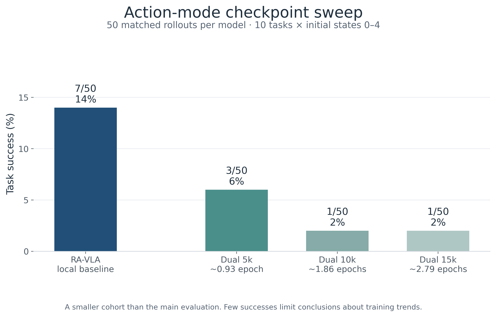
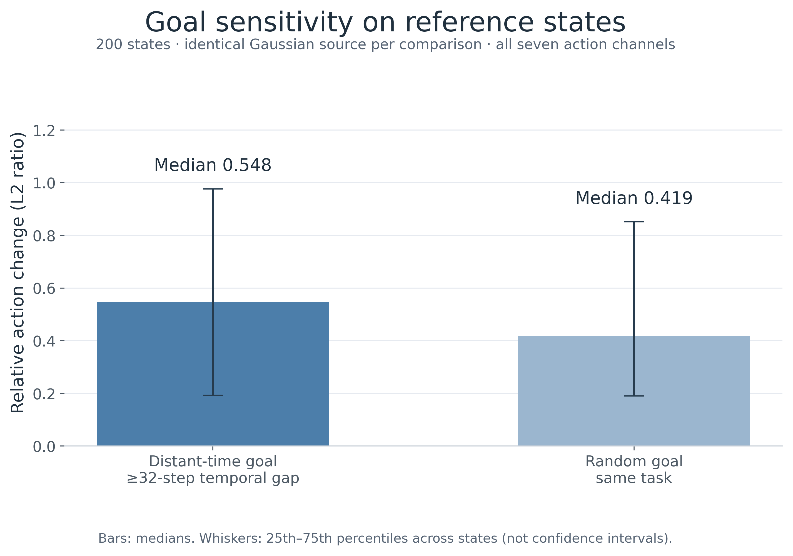

# Dual-Mode RA-VLA on LIBERO-Long — Pilot Results

Prepared: November 2, 2026. Each numbered section is one slide; the appendix is optional.

---

## Slide 1 — Method: From Action Context to Goal Context

**Question:** Can visual milestones improve control when retrieved actions become unreliable?

| Mode | Retrieved conditioning | Flow initialization |
|---|---|---|
| **Mode 1: Action-conditioned** | Reference visual tokens + expert action tokens | Retrieved action mean |
| **Mode 2: Goal-conditioned** | Future milestone visual tokens; expert actions masked with a learned goal token | Gaussian noise |

- Shared action head; frozen Eagle VLM/retriever. Language stays active in both modes.
- Goal: reference frame **+16 steps**; cached features include workspace and wrist views.

> **Figure placeholder:** Shared VLM/action head with action-context and visual-goal branches.

---

## Slide 2 — Training and Evaluation Setup

- **Train:** Goal/Object/Spatial, **171,996 frames**. **Test:** held-out LIBERO-Long, 10 tasks.
- Initialize from GR00T-N1.5; AdamW, LR **2e-4**, batch **32**; **3 epochs / 16,122 updates**.
- **50% action / 50% goal training**, supervised by current-demo actions. Goals use cross-demo DTW +16 steps; temporal-negative gap ≥32.
- Main checkpoint: **15k ≈ 2.79 epochs**. Final checkpoint 16,122 remains unevaluated.
- Shared buffer: **3 demos/task**, stride 4. **100 rollouts/method**; horizon 16, four Euler steps, 1,000-step limit.

**Matched evaluation:** same buffer, initial states and seeds; initial retrieval matched **100/100** pairs.

*Baseline: locally trained RA-VLA. Main results: unperturbed rollouts.*

---

## Slide 3 — Switching with Offline Retrieval-Support Calibration

**Support distance:** $d_t = 1 - \cos(z_t, z_{\mathrm{nearest}})$, computed in FP32.

- Offline, per-task **leave-one-demo-out calibration**: three demos, **567 queries**, equal demo weights.
- Enter Mode 2 above **q90/q95**; exit at **q80**. Thresholds stay fixed.
- Compare **32-step cap** versus **until q80 / episode end**.
- Pin the milestone within each burst; update nearest support every chunk. Cooldown: one action chunk.

*Empirical thresholds, without conformal guarantees; calibration uses two reference demos, runtime three.*



*Illustrative matched pair: task 0 / init 0; capped q90's only success. Aggregate results follow.*

---

## Slide 4 — Main Results: No Improvement from Adaptive Switching

**LIBERO-Long · 100 matched rollouts per method · dual checkpoint 15k**

| Policy | Task success | Control steps in goal mode |
|---|---:|---:|
| **Single-mode RA-VLA, local** | **11/100 — 11%** | — |
| Dual model, action mode only | 3/100 — 3% | 0% |
| Adaptive q90, cap 2 chunks | 1/100 — 1% | 57.3% |
| Adaptive q95, cap 2 chunks | 1/100 — 1% | 54.1% |
| Adaptive q90, until q80 | 0/100 — 0% | 87.0% |
| Adaptive q95, until q80 | 0/100 — 0% | 82.4% |

**Finding:** Regression appears before switching; removing the cap does not improve success.



---

## Slide 5 — Diagnostics: Checkpoint Selection and Goal Sensitivity

**Action-only checkpoint sweep — same 50 initial states: 10 tasks × 5 trials**

| Model | Task success |
|---|---:|
| **Single-mode RA-VLA, local** | **7/50 — 14%** |
| Dual checkpoint 5k | 3/50 — 6% |
| Dual checkpoint 10k | 1/50 — 2% |
| Dual checkpoint 15k | 1/50 — 2% |

Earlier training performs better in this small cohort; no tested checkpoint matches RA-VLA.

**Goal-content probe:** 200 states, identical Gaussian noise.

- Median relative action change: **0.548** with distant-time goals; **0.419** with random same-task goals.
- Goal sensitivity does not establish correct goal following.

*Relative L2 over seven action channels; temporal negatives lack semantic verification.*





*Use the sensitivity panel on a separate diagnostic slide if space is limited.*

---

## Slide 6 — Interpretation and Next Steps

**Observed:** All tested dual-mode variants underperform RA-VLA; recovery benefits remain unverified.

**Unresolved:** training interference, goal/retrieval mismatch and support-score validity.

1. **Matched action-only training control:** isolate joint training from the changed negative-sampling recipe.
2. **Goal-controller positive control:** forced goal mode with scene/phase-matched goals, then small perturbations.
3. **Revise training:** warm-start validated RA-VLA, preserve Mode 1, establish same-demo goal following first.

*Current training uses expert states/actions, without explicit off-manifold recovery supervision.*

> **Figure placeholder:** Paired recovery clips with a correct milestone (proposed experiment).

---

## Optional Appendix — Additional Checks and Source Artifacts

- Initial screening, one trial/task: RA-VLA **0/10**, dual action **0/10**, always-goal **0/10**. Always-goal retains language; this condition has not received a 100-rollout evaluation.
- For capped q90/q95, **92.9% / 95.8% of recorded exits** were forced by the two-chunk cap. The subsequent until-q80 runs recorded zero cap exits.
- The until-q80 runs use a configured cap of 64 chunks, which is unreachable within a 1,000-step episode (at most 63 chunk predictions).
- One training seed was used. Checkpoint-sweep and 100-rollout result tables use different cohort sizes and should remain separate.
- Original adherence uses batch-shuffled negatives; the dual pipeline uses same-task negative rows. This is an additional training confound.
- FP32 distance is computed after renormalizing the vectors selected by legacy BF16 nearest-neighbor retrieval.
- Sensitivity uses all seven denormalized action channels; temporal negatives are sampled ≥32 steps from the retrieved forward goal.

**Sources**

- [Training recipe](outputs/dual_mode/gos_dual_seed42/training_config.json)
- [Data inventory](outputs/dual_mode/gos_dual_seed42/data_inventory.json)
- [RA-VLA baseline results](outputs/ravla_eval/ravla_local_newbuffer_100_20261031/summary.csv)
- [Matched baseline / dual-action audit](outputs/ravla_eval/ravla_local_newbuffer_100_20261031/matched_comparison.json)
- [Action-only and capped switching results](outputs/ravla_eval/support_gate_10trials_15k_20261031/summary.csv)
- [Until-q80 results](outputs/ravla_eval/support_gate_untilq80_10trials_15k_20261031/summary.csv)
- [Checkpoint-sweep comparison](outputs/ravla_eval/ckpt_sweep_comparison_50_20261101.csv)
- [Goal-sensitivity probe](outputs/ravla_eval/dual_diag_probes_15k_20261031/probes/summary.json)
- [Calibration thresholds and provenance](outputs/dual_mode/support_calibration/calibration.json)

**Additional generated figures**

- [Goal-burst outcomes](reports/dual_mode_ravla/figures/03_goal_burst_outcomes.png): denominator includes every entry, including unfinished bursts at episode end.
- [Per-task success heatmap](reports/dual_mode_ravla/figures/06_per_task_success.png): exact successes out of 10 per task.
- [Matched rollout frames](reports/dual_mode_ravla/figures/07_rollout_frames.png): task 0 / init 0, selected example; same timestamps across four policies.

Every figure has **PNG (320 DPI), PDF and SVG** versions in [the figure directory](reports/dual_mode_ravla/figures/README.md). Source CSVs and input hashes are included.

**Reproduce figures** (inside a Slurm allocation; CPU only):

```bash
cd /mnt/data/vhoangth2/repos/Isaac-GR00T-RA-VLA
srun --ntasks=1 --cpus-per-task=1 --cpu-bind=none \
  /home/vhoangth2/miniconda3/envs/gr00t/bin/python \
  -m scripts.rag.plot_dual_mode_results
```

[Plotting script](scripts/rag/plot_dual_mode_results.py). No new rollouts are run.
