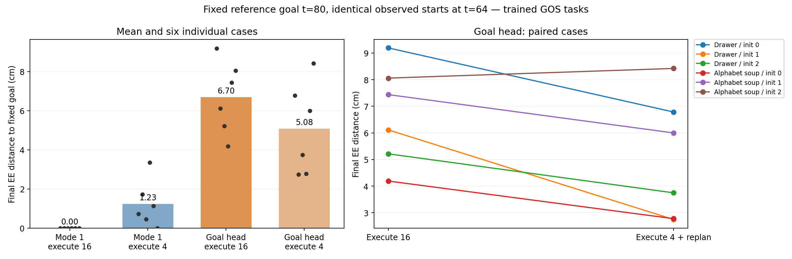

# Fixed-goal controller diagnosis — 2026-11-03

Six successful Mode-1 references, two trained GOS tasks. Replay recorded actions to t=64; keep reference frame 80 as the fixed goal for 16 control steps. RGB and robot proprioception only, with standard benchmark reset.

| Controller | Execute before replanning | Cases | Mean final EE error (cm) | Workspace RGB MAE |
|---|---:|---:|---:|---:|
| Mode 1 | 16 | 6 | 0.00 | 0.00 |
| Mode 1 | 4 | 6 | 1.23 | 2.00 |
| Goal head | 16 | 6 | 6.70 | 7.13 |
| Goal head | 4 | 6 | 5.08 | 6.11 |

Mean initial EE-to-goal distance: **12.31 cm**. Goal execute4 reduces endpoint error by **24.2%** relative to execute16 in this six-case pilot.

## Interpretation

- All prefix frames and paired start observations matched exactly. Mode 1 execute16 reproduced its recorded continuation exactly; its zero error is a reproducibility control, not evidence of perfect general performance.
- The goal head moves toward the fixed milestone but retains substantial local control error. Removing online phase selection did not remove this error, so selector tuning alone is insufficient for these cases.
- More frequent replanning improves the mean goal-head error but leaves a gap to Mode 1. This intervention includes both fresh observation feedback and new Gaussian flow samples; it does not isolate their individual effects.
- EE/RGB errors are proxies, not semantic goal success. These are references from successful Mode-1 rollouts rather than new expert labels. One seed, six starts, one phase per start; not Long SR, goal-grounding proof, or OOD recovery.
- Next focus on goal-controller precision before cross-demo scaling or switching thresholds. No additional training or perturbation job was launched.

Audit: all 24 local videos exist; initial four commands match across execute variants (maximum difference 0). Both per-run observation audits passed.

Runs: outputs/ravla_eval/fixed_goal_prefix64_exec16_20261103, outputs/ravla_eval/fixed_goal_prefix64_exec4_20261103
