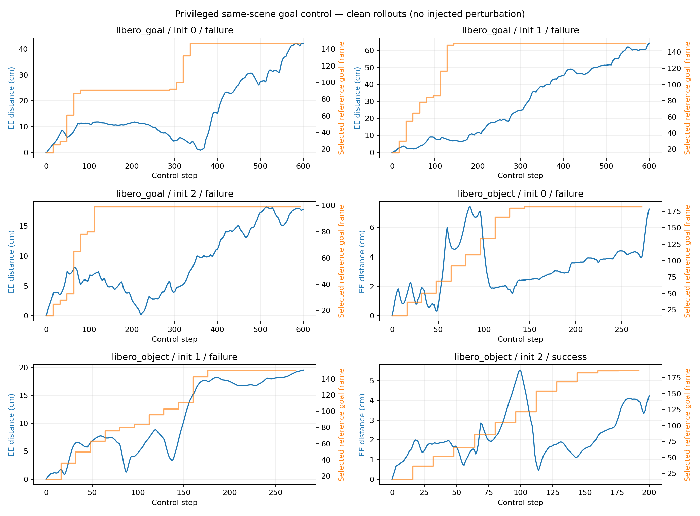

# Same-scene goal-controller pilot — results

These are trained GOS tasks, not held-out Long evaluation.

| Suite / task 0 | Mode-1 reference successes | Goal successes / eligible references |
|---|---:|---:|
| libero_goal | 3/3 | 0/3 |
| libero_object | 3/3 | 1/3 |
| libero_spatial | 0/3 | 0/0 |

Goal success is conditional on successful same-scene reference rollouts; it is not directly comparable to unconditional benchmark SR.

Audit passed for 6 executed goal rollouts: matching initial and post-warm-up simulator state hashes; every goal image hash matches its logged reference frame; monotone bounded phase selection; all executed episodes have trace/video files.

The selector uses privileged physical-state matching, not guaranteed semantic phase labels. EE proximity also does not imply correct object/contact state. There was no injected perturbation and no recovery claim.

